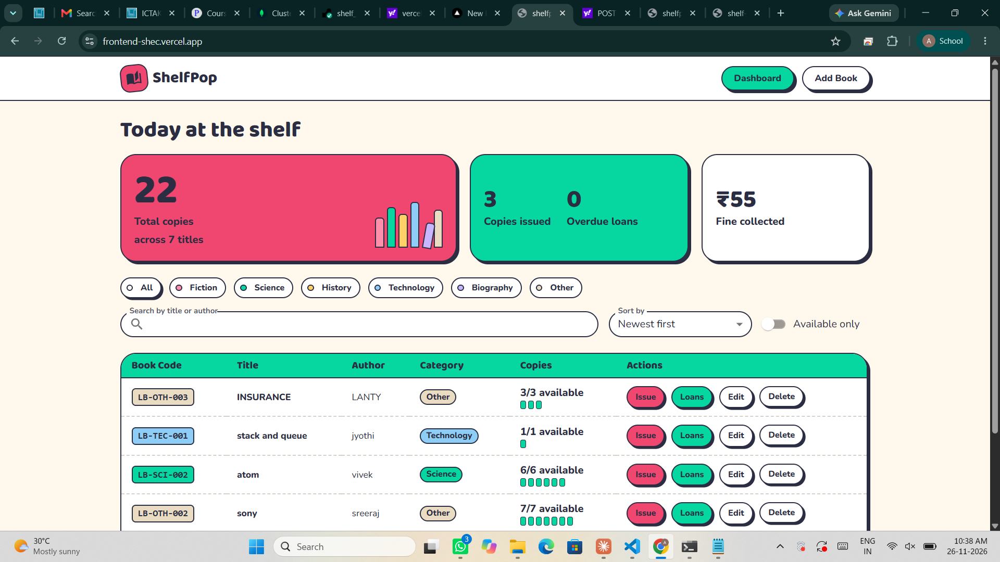
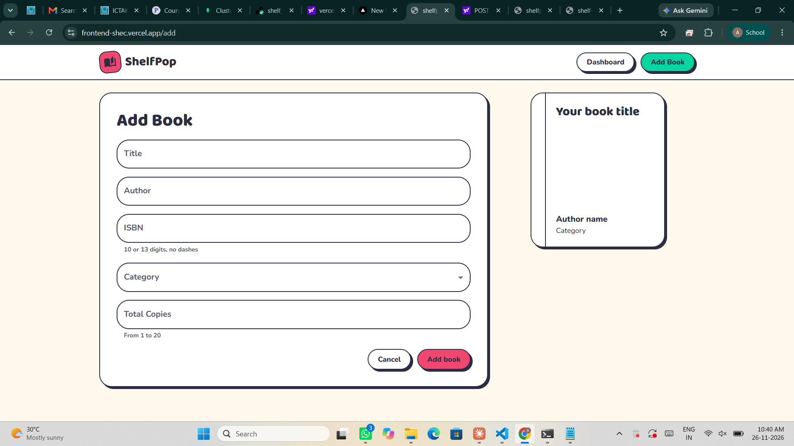

# shelfpop-library

ShelfPop is a Library Book Lending Manager built with MongoDB Atlas, Express, React (Vite) and Node.

## Live Links

- Frontend: https://frontend-shec.vercel.app/
- Backend API: https://shelf-pop.onrender.com

## Run the project

Backend (terminal 1):

```
cd backend
npm install
npm run dev
```

Frontend (terminal 2):

```
cd frontend
npm install
npm run dev
```

Open http://localhost:5173. The API runs on http://localhost:5000.
The `.env` files are included as the exam rules require. They hold exam-only test credentials.

## API list

Every response has the shape `{ success, message, data }`.

| Method | URL | Purpose | Status codes |
|---|---|---|---|
| GET | /api/books?search=&category=&available=true&sort=&page=1 | List books, 5 per page, with totalPages | 200 |
| POST | /api/books | Add a book | 201, 400, 409 |
| GET | /api/books/:id | One book | 200, 404 |
| PUT | /api/books/:id | Edit title, author, total copies | 200, 400, 404 |
| DELETE | /api/books/:id | Delete a book | 200, 404, 409 |
| POST | /api/books/:id/issue | Issue a copy | 201, 400, 404, 409 |
| GET | /api/books/:id/loans | Loan history with isOverdue | 200, 404 |
| PATCH | /api/loans/:id/return | Return a copy and calculate the fine | 200, 404, 409 |
| GET | /api/stats | Library statistics | 200 |

## Screenshots

### Dashboard


### Add Book


### Loan history with fine


## Assumptions

- ISBN is digits only: no dashes, no letter X.
- Conflicts return 409: duplicate ISBN, no copies, member already holds the book, loan already returned, delete with unreturned copies.
- Member ID is not case sensitive (m1 and M1 are the same member).
- Past issue dates are allowed. Future dates are rejected.
- A loan is overdue from the day after its due date. Fine is Rs 5 per late day.
- Book code numbers are never reused after a delete.
- Deleting a book keeps its returned loans, so the total fine collected stays correct.

## Extras

Toast messages, delete confirmation dialog, coloured category chips, sort, stat tiles, live book cover preview, copy indicator blocks, due date preview.

## Test checklist

- [x] Add a book; the code looks like LB-TEC-001
- [x] Same ISBN again shows the duplicate message
- [x] Issue, then issue again to the same member (rejected)
- [x] Issue with a date 20 days ago; Overdue badge shows
- [x] Return it; fine is Rs 30; second return is rejected
- [x] Edit cannot go below issued copies
- [x] Delete is disabled while a copy is issued
- [x] Search, category, Available only, pagination
- [x] Stats update after every action
- [x] Layout works at 375px
